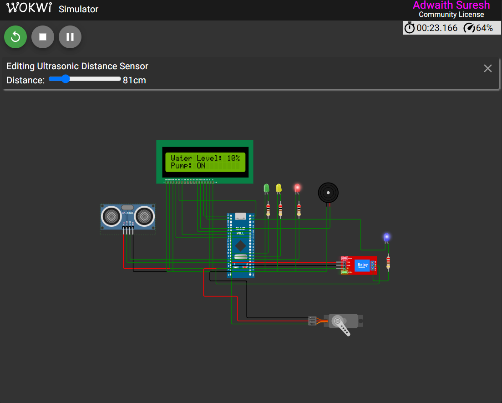
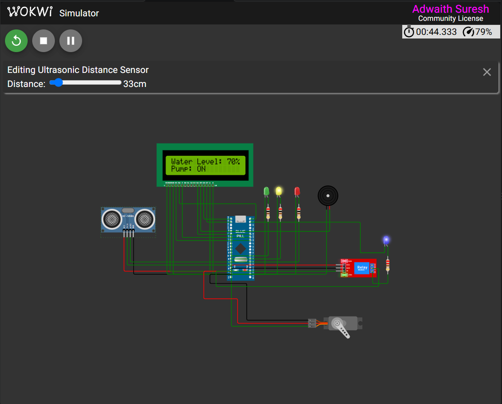
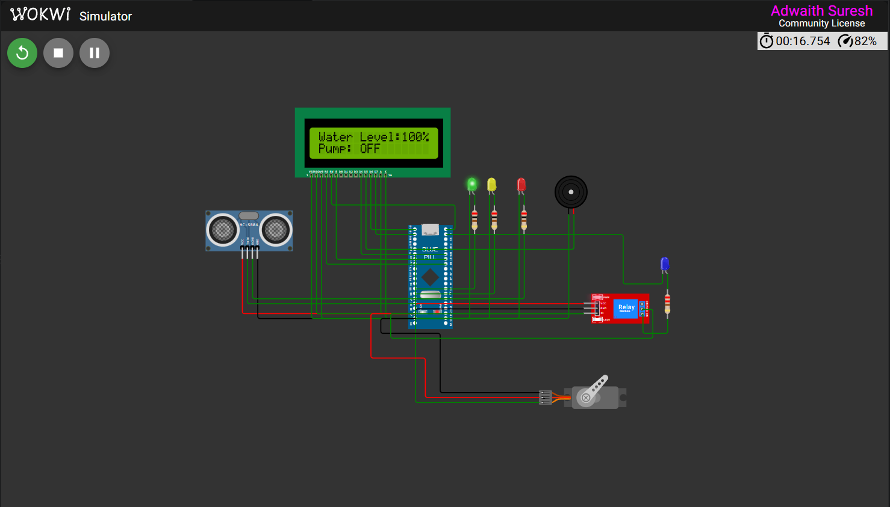

# Smart Water Tank Controller Using STM32F103C8T6

## Project Overview

The Smart Water Tank Controller is an embedded system designed to monitor water levels and automate water pump operation using the STM32F103C8T6 microcontroller.

The system uses an HC-SR04 ultrasonic sensor to measure the distance between the sensor and the water surface. Based on the measured distance, the controller calculates the water level and automatically controls the pump.

## Features

- Real-time water-level monitoring.
- Automatic water pump control using a relay.
- 16×2 LCD display for water-level information.
- Three LED indicators for water-level status.
- Buzzer alert for low-water conditions.
- Servo motor for visual indication.
- Hysteresis-based pump control.

## Hardware Components

- STM32F103C8T6 Blue Pill
- HC-SR04 Ultrasonic Sensor
- 16×2 LCD
- Relay Module
- Red, Yellow and Green LEDs
- Buzzer
- Servo Motor

## Software and Tools

- Embedded C
- STM32CubeMX
- STM32CubeIDE
- STM32 HAL Library
- Wokwi Simulator

## Working Principle

The HC-SR04 sensor measures the distance between the sensor and the water surface. The STM32F103C8T6 processes this measurement and calculates the water level percentage.

The controller displays the water level on the LCD and operates the pump through a relay according to predefined thresholds. LED indicators and a buzzer provide additional status information.

## Simulation

The project was developed and tested using the Wokwi simulation environment.

## Future Enhancements

- IoT-based remote monitoring.
- Mobile application notifications.
- Dry-run protection.
- Water leakage detection.
- Physical hardware implementation.

## Project Status

Simulation and functional verification completed using Wokwi.

## Simulation Results

### 1. Low Water Level – 10%

- Distance: 81 cm
- Water Level: 10%
- Pump Status: ON

### 2. Intermediate Water Level – 70%

- Distance: 33 cm
- Water Level: 70%
- Pump Status: ON

### 3. Full Water Level – 100%

- Distance: 10 cm
- Water Level: 100%
- Pump Status: OFF

